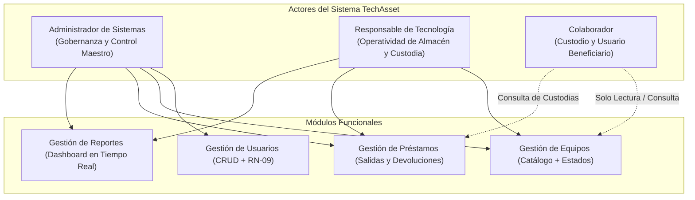
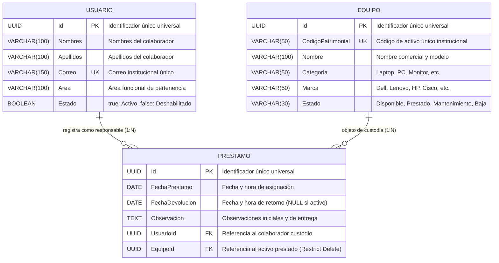
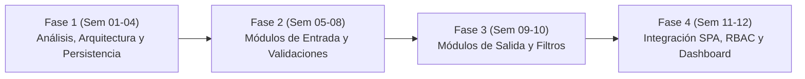

# DOCUMENTO DE ANÁLISIS Y PLANIFICACIÓN DEL PROYECTO
## TechAsset: Sistema de Gestión de Inventario y Préstamo de Equipos Tecnológicos
### Caso Práctico Integrador — Construcción de Software (Semanas 01 a 12)

---

- **Organización Patrocinadora:** Innovatech Solutions S.A.C.
- **Asignatura:** Construcción de Software
- **Ciclo:** 2026-II
- **Entregable Oficial:** Actividad 1 — Análisis y Planificación del Proyecto

---

## 1. Análisis del Problema Real de Gestión Tecnológica

### 1.1. Contexto Empresarial
**Innovatech Solutions S.A.C.** es una organización tecnológica dedicada al desarrollo de software y consultoría digital para clientes corporativos nacionales e internacionales. La compañía cuenta con una plantilla superior a **500 colaboradores** distribuidos en diversas áreas funcionales:
- Tecnología & Infraestructura
- Desarrollo de Software
- Operaciones y Logística
- Calidad y Testing
- Gerencia y Administración

Para el cumplimiento de sus labores, la empresa administra un parque heterogéneo de activos informáticos que comprende:
1. Laptops corporativas de alta y media gama
2. Computadoras de escritorio (Workstations)
3. Monitores profesionales de alta resolución
4. Impresoras láser y térmicas de red
5. Tablets para pruebas de campo y control de inventario
6. Proyectores multimedia para salas de reuniones
7. Equipos de infraestructura de red (switches, routers y puntos de acceso)

### 1.2. Diagnóstico de la Situación Inicial (Problemática)
Históricamente, el inventario y las custodias temporales de estos activos se registraban en hojas de cálculo compartidas y cuadernos de control físico en el almacén de TI. Dicha metodología manual provocaba graves deficiencias operativas y financieras:
- **Pérdida de información:** Extravío de planillas físicas y sobreescritura accidental de celdas en hojas de cálculo.
- **Duplicidad de registros:** Falta de unicidad en los códigos patrimoniales y correos de colaboradores.
- **Ausencia de control de préstamos:** Carencia de registros formales que certifiquen quién tiene cada equipo y desde qué fecha.
- **Desconocimiento de la ubicación física:** Incapacidad de rastrear rápidamente el área física o piso donde opera un equipo asignado.
- **Incertidumbre en la disponibilidad de activos:** Pérdida de tiempo del equipo de soporte al no saber con certeza si un equipo está libre, prestado o dañado.
- **Ausencia de indicadores ejecutivos:** Imposibilidad de tomar decisiones de compra o renovación tecnológica basadas en métricas de rotación y demanda por área.
- **Procesos lentos y desarticulados:** Asignaciones y devoluciones demoraban excesivo tiempo y no contemplaban inspección física formal ni registro de observaciones.

### 1.3. Propósito de la Solución (TechAsset)
La Gerencia de Tecnología dispuso el desarrollo de **TechAsset**, un sistema web corporativo, reactivo y de alta disponibilidad destinado a:
1. Centralizar el catálogo institucional de activos tecnológicos con códigos patrimoniales únicos.
2. Controlar el ciclo de vida operativo de los equipos (*Disponible*, *Prestado*, *Mantenimiento*, *Baja*).
3. Administrar el flujo formal de préstamos y devoluciones con inspección física y registro mandatorio de observaciones.
4. Generar tableros de control ejecutivos (Dashboard) en tiempo real para optimizar la toma de decisiones.

---

## 2. Actores del Sistema y Modelo de Accesos (RBAC)

De acuerdo con la **Sección 5** del Caso Práctico Integrador, se definen tres actores formales:

### 2.1. Administrador de Sistemas
- **Definición:** Máxima autoridad responsable de administrar la información, la gobernanza y la seguridad del sistema.
- **Funciones Asignadas:**
  - Gestionar usuarios (altas, modificaciones, consultas y deshabilitación mediante soft delete según **RN-09**).
  - Gestionar catálogo maestro de equipos tecnológicos (creación, edición, eliminación y cambio de estado).
  - Consultar reportes e indicadores ejecutivos consolidados.
  - Supervisar préstamos y auditoría institucional de custodias.

### 2.2. Responsable de Tecnología (Soporte TI)
- **Definición:** Responsable operativo de la asignación, control y recepción física de los equipos tecnológicos en almacén.
- **Funciones Asignadas:**
  - Registrar nuevos activos tecnológicos en el catálogo institucional.
  - Aprobar y formalizar salidas de préstamo a colaboradores autorizados.
  - Registrar devoluciones con inspección física y observaciones obligatorias.
  - Consultar inventario y actualizar el estado operativo de los equipos (*Disponible*, *Mantenimiento*, etc.).
  - *Restricción de seguridad:* No tiene acceso a la administración de usuarios ni a deshabilitar cuentas.

### 2.3. Colaborador
- **Definición:** Usuario institucional perteneciente a cualquiera de las áreas funcionales de la empresa que utiliza activos para el desempeño de sus labores.
- **Funciones Asignadas:**
  - Consultar la disponibilidad de equipos en tiempo real en el inventario.
  - Consultar su historial de préstamos y custodias asignadas.
  - *Restricción de seguridad:* Modo de solo lectura; no puede modificar estados de equipos, ni crear usuarios, ni registrar devoluciones formales por cuenta propia.

### 2.4. Matriz de Control de Accesos por Rol (RBAC)

| Módulo / Funcionalidad | Ruta Frontend | Administrador | Responsable de Tecnología | Colaborador |
| :--- | :--- | :---: | :---: | :---: |
| **Visualizar Dashboard General** | `/dashboard` | Acceso Total con Acciones Rápidas | Acceso Total con Acciones de Hardware | Modo Consulta Informativo |
| **Consultar Inventario de Equipos** | `/equipos` | Acceso Total | Acceso Total | Solo Lectura |
| **Registrar Nuevo Equipo** | `/equipos/nuevo` | Permitido | Permitido | Bloqueado |
| **Modificar Estado de Equipo** | Modal `/equipos` | Permitido | Permitido | Bloqueado |
| **Eliminar Equipo del Catálogo** | Modal `/equipos` | Permitido (si no tiene historial) | Bloqueado | Bloqueado |
| **Consultar Historial de Préstamos** | `/prestamos` | Acceso Total | Acceso Total | Consulta de Custodias |
| **Registrar Salida de Préstamo** | `/prestamos/nuevo` | Permitido | Permitido | Bloqueado |
| **Registrar Retorno / Devolución** | Modal `/prestamos` | Permitido | Permitido | Bloqueado |
| **Directorio de Colaboradores** | `/usuarios` | Acceso Total | Bloqueado (Oculto en UI) | Bloqueado (Oculto en UI) |
| **Registrar Nuevo Colaborador** | `/usuarios/nuevo` | Permitido | Bloqueado (Ruta protegida) | Bloqueado (Ruta protegida) |
| **Deshabilitar / Habilitar Usuario** | Modal `/usuarios` | Exclusivo (**RN-09**) | Bloqueado | Bloqueado |

---

## 3. Especificación de Requerimientos Funcionales

| Código | Módulo | Requerimiento Funcional | Entradas | Salidas / Efecto |
| :--- | :--- | :--- | :--- | :--- |
| **RF-01** | Usuarios | Registrar usuarios institucionales. | Nombres, Apellidos, Correo, Área funcional. | Usuario creado con ID UUID único, estado activo y validación de unicidad de correo (**RN-08**). |
| **RF-02** | Usuarios | Actualizar datos de usuarios. | ID de usuario, datos modificados. | Registro actualizado en base de datos. |
| **RF-03** | Usuarios | Consultar padrón de usuarios. | Criterio de búsqueda (opcional). | Listado paginado de colaboradores con badge de área y estado. |
| **RF-04** | Usuarios | Deshabilitar usuarios (soft-delete). | ID de usuario, confirmación de Administrador. | Estado pasa a `false`, inhabilitándolo para recibir nuevos préstamos (**RN-09**). |
| **RF-05** | Equipos | Registrar equipos tecnológicos. | Código patrimonial, Nombre, Categoría, Marca, Estado inicial. | Activo guardado con código patrimonial único (**RN-07**). |
| **RF-06** | Equipos | Actualizar equipos tecnológicos. | ID de equipo, nuevos atributos. | Características del activo actualizadas. |
| **RF-07** | Equipos | Consultar inventario de equipos. | Filtros de categoría, estado y término de texto. | Tabla interactiva con badges y conteo histórico de préstamos. |
| **RF-08** | Equipos | Actualizar estado operativo del activo. | ID de equipo, nuevo estado (*Disponible*, *Mantenimiento*, *Baja*). | Transición de estado registrada con validación de no estar prestado. |
| **RF-09** | Préstamos | Registrar préstamo de equipo. | ID Colaborador, ID Equipo, Observación inicial. | Préstamo registrado con fecha actual; estado del equipo pasa automáticamente a **Prestado** (**RN-01**, **RN-05**). |
| **RF-10** | Préstamos | Registrar devolución de equipo. | ID Préstamo, Observaciones físicas de retorno. | Fecha de devolución registrada; estado del equipo pasa a **Disponible** (**RN-04**, **RN-10**). |
| **RF-11** | Préstamos | Consultar historial de préstamos. | Criterio de búsqueda, paginador. | Listado cronológico de movimientos con trazabilidad completa. |
| **RF-12** | Préstamos | Consultar préstamos activos. | Filtro "Solo Préstamos Activos". | Listado de activos actualmente en custodia y pendientes de retorno. |
| **RF-13** | Reportes | Visualizar dashboard general. | Petición a endpoint agregador. | Tablero ejecutivo con los 6 KPIs normativos en tiempo real. |
| **RF-14** | Reportes | Consultar equipos por estado. | Criterio de estado operativo. | Conteo y filtrado segmentado de activos. |
| **RF-15** | Reportes | Consultar equipos más solicitados. | Datos históricos agregados. | Ranking Top de equipos con mayor frecuencia de préstamos. |
| **RF-16** | Reportes | Consultar préstamos por área. | Agrupación relacional Usuario-Área. | Distribución de demanda en barras porcentuales por área funcional. |
| **RF-17** | Reportes | Consultar historial reciente de movimientos. | Límite de últimos registros. | Tarjetas y filas resumen de últimas asignaciones y retornos. |

---

## 4. Especificación Formal de Reglas de Negocio

| Código | Regla de Negocio | Impacto en el Sistema y Mecanismo de Control |
| :--- | :--- | :--- |
| **RN-01** | *Un equipo solo puede estar asociado a un préstamo activo.* | Al registrar un préstamo en `PrestamoService`, se verifica que el equipo tenga `Estado == "Disponible"`. Si tiene un préstamo sin fecha de devolución, se rechaza la solicitud con HTTP 400. |
| **RN-02** | *No se puede prestar un equipo en estado "Mantenimiento".* | El selector del formulario de préstamos filtra exclusivamente equipos en estado "Disponible". Si se envía por API un equipo en mantenimiento, el backend arroja excepción de negocio. |
| **RN-03** | *No se puede prestar un equipo en estado "Baja".* | Similar a RN-02; los equipos desincorporados quedan bloqueados para cualquier asignación operativa. |
| **RN-04** | *La fecha de devolución debe ser posterior a la fecha de préstamo.* | En la devolución (`RegistrarDevolucion`), el backend asigna la estampa de tiempo actual del servidor ($FechaDevolucion \ge FechaPrestamo$). |
| **RN-05** | *Todo préstamo debe registrar un responsable.* | Clave foránea `UsuarioId` obligatoria (`NOT NULL`) con verificación previa de que el colaborador exista y se encuentre en estado activo (`Estado == true`). |
| **RN-06** | *No se puede eliminar un equipo con historial de préstamos.* | En `AppDbContext`, la relación `Prestamo.Equipo` está configurada con `DeleteBehavior.Restrict`. Adicionalmente, el frontend deshabilita el botón de eliminación si `totalPrestamos > 0`. |
| **RN-07** | *El código patrimonial debe ser único.* | Índice único a nivel de base de datos (`builder.HasIndex(e => e.CodigoPatrimonial).IsUnique()`) y validación previa en `EquipoService`. |
| **RN-08** | *El correo electrónico del usuario debe ser único.* | Índice único (`builder.HasIndex(u => u.Correo).IsUnique()`) y normalización previa (`Trim().ToLower()`). |
| **RN-09** | *Solo el Administrador podrá deshabilitar usuarios.* | Restricción implementada en la UI mediante control de rol en `UsuariosList.jsx` y comprobación de permisos RBAC en el contexto de autenticación. |
| **RN-10** | *Toda devolución deberá registrar observaciones.* | Campo `ObservacionDevolucion` obligatorio con validación de longitud mínima de 5 caracteres tanto en frontend como en el endpoint del backend. |

---

## 5. Modelo de Datos Referencial

### 5.1. Diagrama Entidad-Relación (Mermaid)

### 5.2. Diccionario de Datos

#### Tabla: `Usuarios`
| Columna | Tipo SQL | Nulo | Descripción y Restricciones |
| :--- | :--- | :---: | :--- |
| `Id` | `UUID` | No | Clave primaria generada por el sistema. |
| `Nombres` | `VARCHAR(100)` | No | Nombres de pila del colaborador (mínimo 2 caracteres). |
| `Apellidos` | `VARCHAR(100)` | No | Apellidos paterno y materno del colaborador. |
| `Correo` | `VARCHAR(150)` | No | Correo institucional único (`UNIQUE INDEX`), normalizado en minúsculas. |
| `Area` | `VARCHAR(100)` | No | Área departamental (*Tecnología*, *Desarrollo*, *Operaciones*, etc.). |
| `Estado` | `BOOLEAN` | No | Bandera lógica de habilitación (*true* = activo, *false* = inhabilitado). |

#### Tabla: `Equipos`
| Columna | Tipo SQL | Nulo | Descripción y Restricciones |
| :--- | :--- | :---: | :--- |
| `Id` | `UUID` | No | Clave primaria generada por el sistema. |
| `CodigoPatrimonial` | `VARCHAR(50)` | No | Código patrimonial único institucional (`UNIQUE INDEX`), formato estandarizado. |
| `Nombre` | `VARCHAR(100)` | No | Descripción técnica y modelo del activo. |
| `Categoria` | `VARCHAR(50)` | No | Familia de activo (*Laptop*, *Computadora de escritorio*, *Monitor*, etc.). |
| `Marca` | `VARCHAR(50)` | No | Fabricante tecnológico (*Dell*, *HP*, *Apple*, *Lenovo*, *Epson*, etc.). |
| `Estado` | `VARCHAR(30)` | No | Estado del ciclo de vida (*Disponible*, *Prestado*, *Mantenimiento*, *Baja*). |

#### Tabla: `Prestamos`
| Columna | Tipo SQL | Nulo | Descripción y Restricciones |
| :--- | :--- | :---: | :--- |
| `Id` | `UUID` | No | Clave primaria generada por el sistema. |
| `FechaPrestamo` | `TIMESTAMP / DATE` | No | Estampa cronológica del momento de la asignación. |
| `FechaDevolucion` | `TIMESTAMP / DATE` | Sí | Estampa cronológica del retorno físico. Si es `NULL`, el préstamo está activo. |
| `Observacion` | `TEXT` | No | Bitácora de entrega y notas de la inspección física de retorno (**RN-10**). |
| `UsuarioId` | `UUID` | No | Clave foránea referenciando a `Usuarios(Id)`. |
| `EquipoId` | `UUID` | No | Clave foránea referenciando a `Equipos(Id)` con `ON DELETE RESTRICT` (**RN-06**). |

---

## 6. Ciclo de Vida del Software y Planificación

### 6.1. Selección del Ciclo de Vida
Se adoptó un modelo **Iterativo e Incremental ágil (basado en Scrum)**, complementado con entregas semanales orientadas a los hitos de la asignatura:

### 6.2. Cronograma de Iteraciones y Hitos Evaluados

| Fase / Sprint | Semanas | Alcance Técnico Implementado | Entregable Asociado |
| :--- | :---: | :--- | :--- |
| **Iteración 1** | 01 – 04 | Análisis del problema, modelado relacional en PostgreSQL, configuración de solución en .NET 8 con Clean Architecture, entidades y repositorios base. | Documento de Análisis, Repositorio Git inicial y modelos de dominio. |
| **Iteración 2** | 05 – 08 | Desarrollo de formularios de captura (`CreateUsuario`, `CreateEquipo`, `CreatePrestamo`), validaciones con DataAnnotations y reglas RN-01 a RN-08. | Formularios funcionales validados en frontend y backend. |
| **Iteración 3** | 09 – 10 | Desarrollo de listados interactivos con paginación, filtros multicriterio, badges semánticos y soporte para la regla RN-06. | Módulos de salida de datos y consultas optimizadas. |
| **Iteración 4** | 11 – 12 | Integración del Dashboard con los 6 indicadores normativos, implementación de control de accesos RBAC, diseño responsive adaptativo y pruebas de escenarios mínimos. | Sistema integrado funcional, Informe Técnico y Sustentación. |

---

## 7. Estándares de Construcción de Software

### 7.1. Clean Architecture (Arquitectura en Cebolla)
El backend está estructurado en 4 capas estrictamente desacopladas:
1. **`TechAsset.Domain`:** Entidades (`Usuario`, `Equipo`, `Prestamo`) sin dependencias de base de datos ni frameworks externos.
2. **`TechAsset.Application`:** Lógica de negocio pura, DTOs de transporte y contratos de interfaces (`IUsuarioService`, `IEquipoRepository`, etc.).
3. **`TechAsset.Infrastructure`:** Contexto EF Core 8 (`AppDbContext`), configuración de índices, relaciones restrictivas e implementaciones concretas de repositorios.
4. **`TechAsset.API`:** Controladores RESTful con inyección de dependencias, documentación Swagger/OpenAPI y serialización JSON homogénea.

### 7.2. Principios de Diseño Aplicados
- **Principio de Responsabilidad Única (SRP):** Cada servicio se enfoca exclusivamente en su agregado (`EquipoService` administra activos, `PrestamoService` administra custodias).
- **Principio de Inversión de Dependencias (DIP):** Los controladores y servicios dependen de interfaces abstractas, permitiendo sustituir la base de datos o agregar pruebas unitarias sin modificar la lógica.
- **Atomic Design y Container-Presentational Pattern en Frontend:** Componentes puros de presentación (`Button`, `InputField`, `StatusBadge`, `Modal`) desacoplados de páginas que manejan estado de red (`Dashboard`, `EquiposList`, `PrestamosList`).
- **Defensive Programming & Fail-Fast:** Toda operación valida precondiciones y restricciones de negocio antes de intentar transacciones sobre la base de datos.
